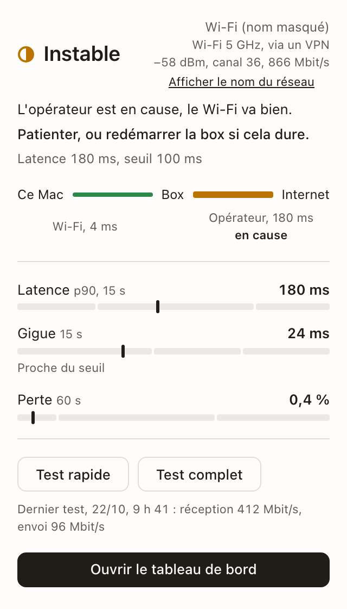
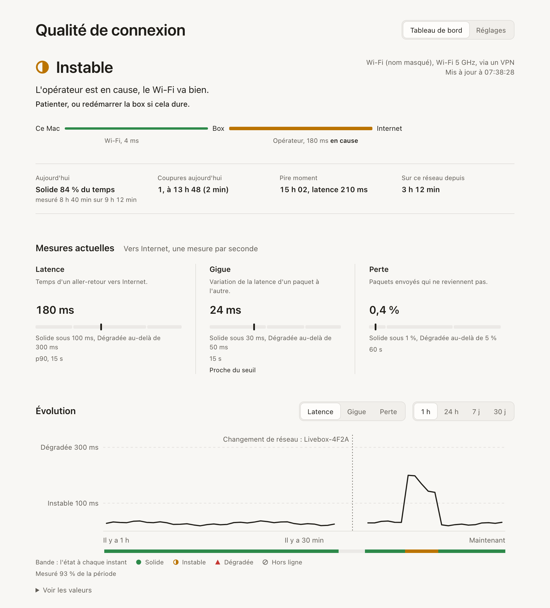
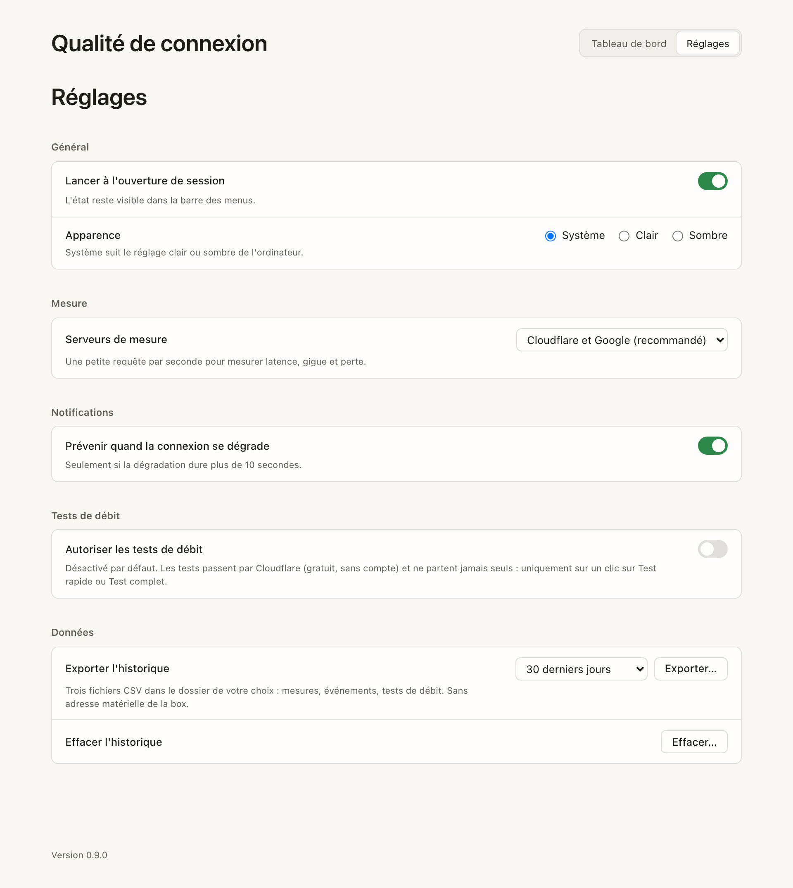

# Qualité de connexion

**Savoir d'un coup d'œil si la connexion tient, et pourquoi elle flanche.**

Une pastille dans la barre des menus suit en continu la latence, la gigue et la perte vers Internet, et passe de **Solide** à **Instable**, **Dégradée** ou **Hors ligne**. Un clic dit ce qui ne va pas, en une phrase : le Wi-Fi, la box ou l'opérateur. App de bureau pour macOS, Windows et Linux, gratuite, locale d'abord : par défaut, seuls de petits pings quittent l'ordinateur.

<!-- x-release-please-start-version -->

> Version actuelle : 0.9.2.

<!-- x-release-please-end -->

<p align="center">
  <picture>
    <source media="(prefers-color-scheme: dark)" srcset="docs/images/popover-dark.png">
    
  </picture>
</p>

## Ce qu'elle fait

- **Un état clair, en continu** : une mesure par seconde vers deux serveurs publics, et un verdict qui ne clignote pas (un état plus mauvais ne s'affiche qu'après 10 secondes soutenues).
- **La cause en une phrase, avec quoi faire** : le chemin Ce Mac → Box → Internet montre le tronçon en cause (Wi-Fi faible, box, opérateur, réseau mobile).
- **Un tableau de bord** : la journée en un coup d'œil, l'évolution sur 1 h à 30 jours, la comparaison des réseaux utilisés et le plus fiable pour la visio.
- **Des tests de débit sur un clic**, désactivés par défaut : rien ne part sans vous.
- **Une notification** quand la connexion se dégrade durablement.
- **Tout reste sur la machine** : historique local (minutes sur 30 jours, heures sans limite), export en CSV, effacement en un clic.

### Tableau de bord

<picture>
  <source media="(prefers-color-scheme: dark)" srcset="docs/images/dashboard-dark.png">
  
</picture>

### Réglages

<picture>
  <source media="(prefers-color-scheme: dark)" srcset="docs/images/settings-dark.png">
  
</picture>

Les captures suivent le thème de votre page GitHub, clair ou sombre, comme l'app suit celui du système. Les données affichées sont fictives.

## Installer

### Télécharger

Chaque version est publiée sur la page [Releases](https://github.com/LucasLaurens/network-quality-desktop/releases), avec un installeur par système quand la CI a pu les construire :

| Système               | Fichier                                               |
| --------------------- | ----------------------------------------------------- |
| macOS (Apple Silicon) | `.dmg` : ouvrir, puis glisser l'app dans Applications |
| Windows               | `.msi` ou `.exe`                                      |
| Linux                 | `.deb`, `.rpm` ou `.AppImage`                         |

La v0.9.0 a été publiée sans installeurs : installez-la depuis les sources (ci-dessous).

Les installeurs ne sont pas signés (usage personnel) :

- **macOS** : au premier lancement, clic droit sur l'app puis « Ouvrir » (ou Réglages Système → Confidentialité et sécurité → « Ouvrir quand même »).
- **Windows** : SmartScreen avertit ; « Informations complémentaires » puis « Exécuter quand même ».

### Depuis les sources

Avec les [prérequis](#prérequis) installés :

```bash
git clone https://github.com/LucasLaurens/network-quality-desktop.git
cd network-quality-desktop
pnpm install
make install
```

Sur macOS, `make install` construit l'app et la copie dans Applications. Sur Windows et Linux, il construit les installeurs dans `target/release/bundle/` : lancez celui de votre système. Pour mettre à jour, `git pull` puis `make install` à nouveau.

## Utiliser

1. **Lancez « Qualité de connexion »**. Elle vit dans la barre des menus (la zone de notification sous Windows), sous la forme d'une pastille ; sur macOS, elle n'a pas d'icône dans le Dock. Les premières secondes affichent « Mesure en cours ».
2. **Lisez la pastille** :

   | Pastille | État            | Ce que ça veut dire                                                         |
   | -------- | --------------- | --------------------------------------------------------------------------- |
   | ● vert   | Solide          | Bonne connexion pour la visio.                                              |
   | ◐ ambre  | Instable        | Une mesure est entre ses deux seuils : la visio peut hacher.                |
   | ▲ rouge  | Dégradée        | Une mesure dépasse son seuil haut : la visio souffre.                       |
   | ⊘ gris   | Hors ligne      | Aucun serveur ne répond depuis 5 secondes.                                  |
   | ◌ bleu   | Mesure en cours | Les 10 premières mesures, au démarrage, au réveil ou sur un nouveau réseau. |

3. **Cliquez sur la pastille** pour le popover : l'état, le réseau, la cause et quoi faire, le tronçon en cause et les trois mesures. Clic droit : le menu (tableau de bord, tests de débit s'ils sont autorisés, Réglages, Quitter). Sous Linux, la pastille n'ouvre que ce menu.
4. **Ouvrez le tableau de bord** pour la journée, l'évolution et vos réseaux ; les détails techniques, repliés en bas, montrent le Wi-Fi, le trafic et la ligne de la box.
5. **Réglez dans Réglages** : lancement à l'ouverture de session, apparence, serveurs de mesure, notifications, tests de débit, export et effacement de l'historique.
6. **Quittez** par « Quitter » dans le menu de la pastille, ou ⌘Q sur macOS. Fermer le tableau de bord ne fait que le cacher : la mesure continue.

Bon à savoir :

- **macOS** demande l'accès à la localisation pour afficher le nom du Wi-Fi (sans lui, le réseau s'affiche « nom masqué ») et l'autorisation des notifications.
- **Linux** : sur GNOME, la pastille demande l'extension AppIndicator ; sans barre système, l'app reste ouverte dans une fenêtre. Si le système refuse le ping, l'app mesure quand même Internet et explique comment l'autoriser.
- **Confidentialité** : ce qui quitte l'ordinateur, vers qui et à quelle fréquence est détaillé dans [Confidentialité](docs/fonctionnel/confidentialite.md).

## Développer

### Prérequis

- Rust : la version est fixée par `rust-toolchain.toml` (installée automatiquement par rustup).
- Node : version de `.node-version`. pnpm : version du champ `packageManager` de `package.json` (`npm i -g pnpm@<version>`).
- Dépendances système de Tauri 2 : voir <https://v2.tauri.app/start/prerequisites/>.
- `cargo-nextest` pour les tests Rust : `cargo install cargo-nextest --locked`.
- Pour les contrôles hors barrière quotidienne : `cargo-llvm-cov` (avec `rustup component add llvm-tools-preview`), `cargo-deny` et `cargo-mutants`, chacun par `cargo install <outil> --locked`.

### Démarrer

```bash
pnpm install
make dev
```

### Commandes

| Commande                             | Effet                                                               |
| ------------------------------------ | ------------------------------------------------------------------- |
| `make dev`                           | Lance l'app en développement (rechargement à chaud du front).       |
| `make build`                         | Construit les installeurs de l'app.                                 |
| `make install`                       | Construit l'app ; sur macOS, la copie dans Applications.            |
| `make test`                          | Tous les tests (front puis Rust).                                   |
| `make test-front` / `make test-back` | Tests du front (Vitest) ou de Rust (nextest).                       |
| `make test-smoke`                    | Les vrais adaptateurs du système (réseau, Wi-Fi, horloge, barre).   |
| `make test-visual`                   | Mise en page mesurée en clair et sombre (Playwright).               |
| `make lint`                          | Lint du front (ESLint) et de Rust (rustfmt, clippy).                |
| `make fmt`                           | Formate tout le code.                                               |
| `make ci`                            | Rejoue en local toute la barrière de la CI.                         |
| `make coverage`                      | Couverture bloquante : `domain` ≥ 90 %, `application` ≥ 80 %.       |
| `pnpm screenshots`                   | Refait les captures du README (aperçus servis par `pnpm dev:web`).  |
| `make audit`                         | Licences et failles des dépendances (`cargo-deny`, `pnpm audit`).   |
| `make mutants`                       | Tests de mutation du domaine (long).                                |
| `make release`                       | Fusionne la PR de release en attente : tag, changelog, installeurs. |

Les commandes sont définies une seule fois dans `package.json` ; le `Makefile` n'est qu'un raccourci (sous Windows, utiliser `pnpm <script>`).

### Documentation

- [Documentation fonctionnelle](docs/fonctionnel/) : ce que fait l'app.
- [Documentation technique](docs/technique/) : architecture, outillage, [releases](docs/technique/releases.md), glossaire.
- [PRODUCT.md](PRODUCT.md) : utilisateurs, personnalité, principes de design.
- [DESIGN.md](DESIGN.md) : système visuel.
